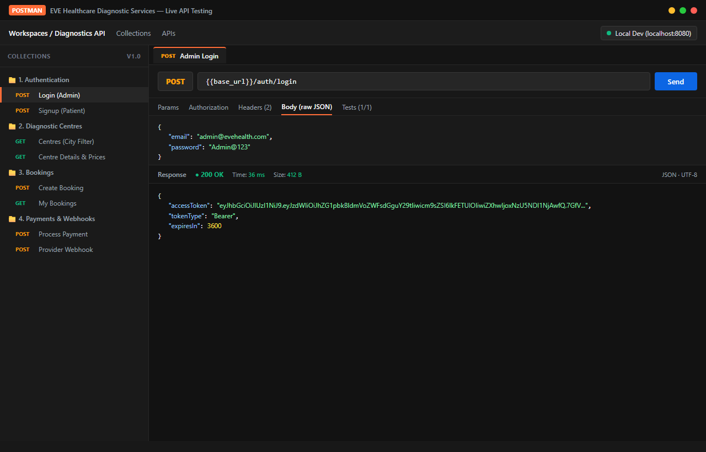
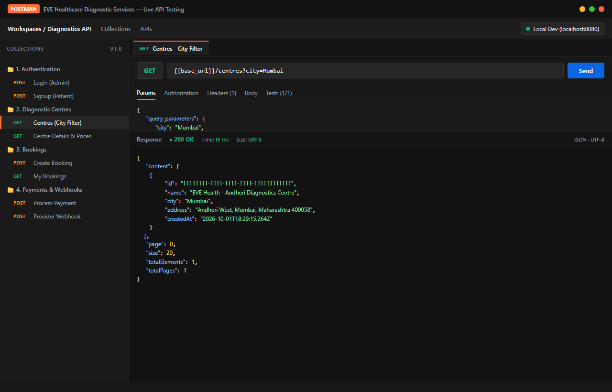
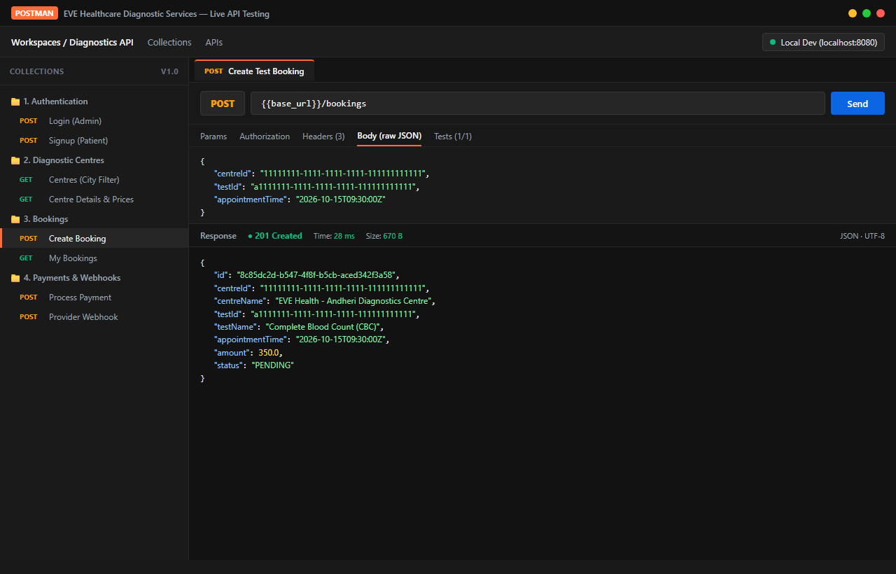
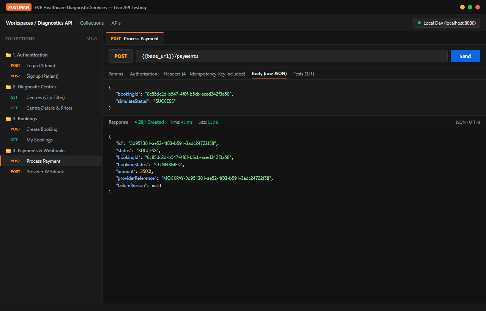
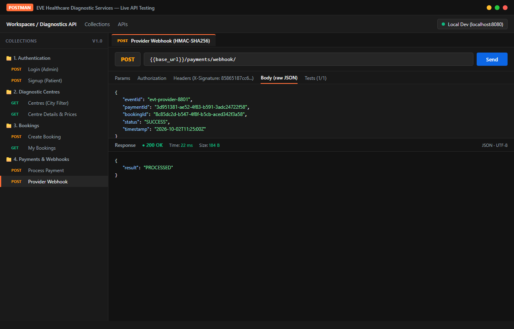
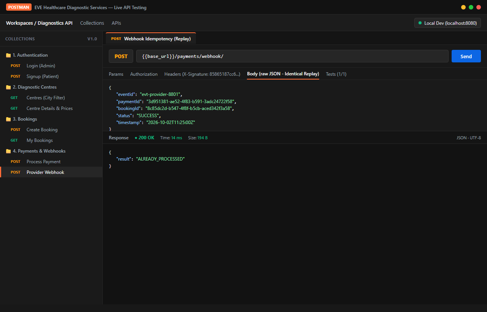
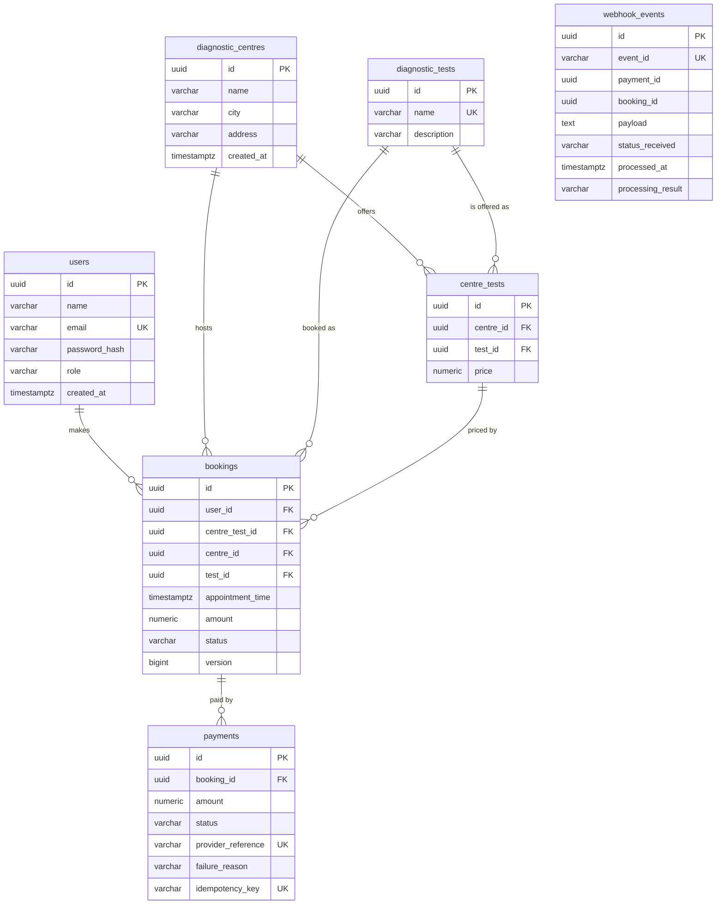
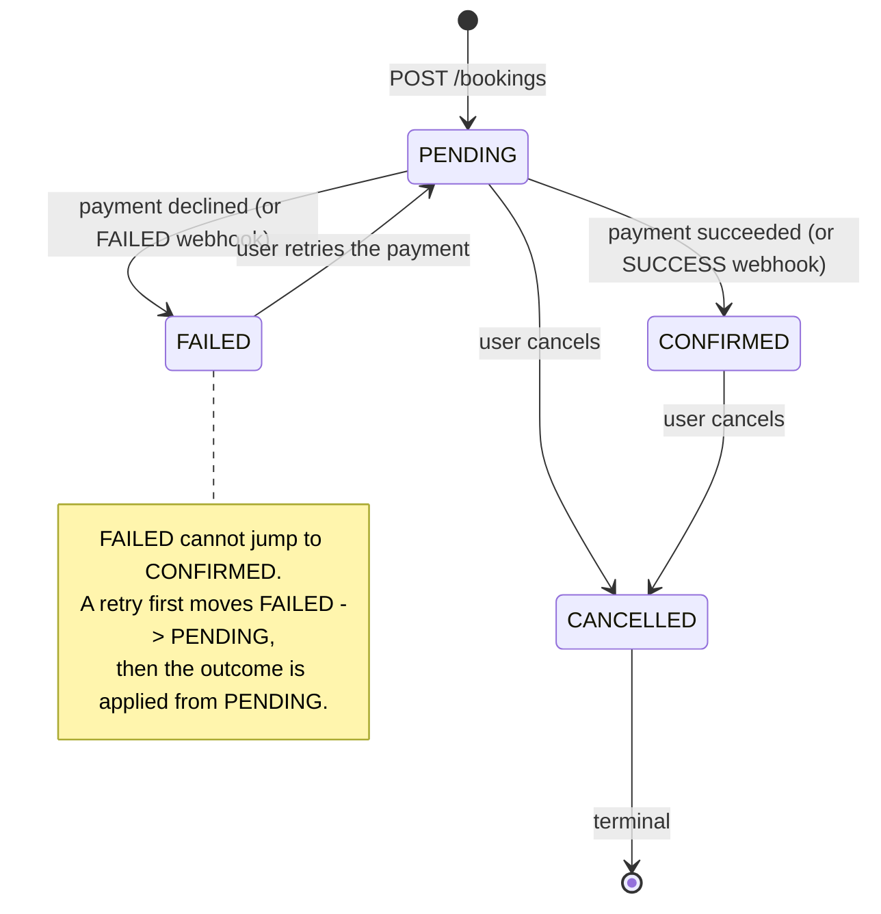

# EVE Healthcare - Diagnostic Bookings & Simulated Payments

A Spring Boot backend for booking diagnostic tests at a centre and paying for them through a
**mock** payment gateway. Users sign up, log in with a JWT, browse the catalogue, book a test,
pay, and a signed payment **webhook** updates the booking. The webhook is idempotent.

There is no real payment provider anywhere in this project.

---

## 1. Overview

Users register, browse diagnostic centres and the tests each offers, book a test at a fixed
appointment time, and pay for it. A simulated gateway approves or declines the payment, and a
provider-style webhook (HMAC-signed and safe to retry) can later correct the outcome - for example
turning a failure into a success.

The interesting part of this project is not the CRUD. It is what happens when the same request
arrives twice:

- **Paying twice.** Two simultaneous `POST /payments` for one booking must charge the customer
  once. Solved with optimistic locking on `bookings.version`.
- **A retried webhook.** Providers redeliver until they get a 2xx, sometimes concurrently. Solved
  with a `UNIQUE` constraint on `webhook_events.event_id` rather than a check-then-insert.
- **Out-of-order webhooks.** A late "failed" must not undo a confirmed payment. Solved by
  checking the booking state machine before applying anything.

### Tech stack

| Concern | Choice |
|---|---|
| Language | Java 17 |
| Framework | Spring Boot 3.5 (Maven) |
| Web / MVC | Spring Web |
| Persistence | Spring Data JPA (Hibernate) |
| Database | PostgreSQL 16 |
| Schema migrations | Flyway |
| Auth | Spring Security + JWT (jjwt 0.12) |
| Validation | Jakarta Bean Validation |
| API docs | springdoc-openapi (Swagger UI) |
| Boilerplate | Lombok (only `@Getter`/`@Setter`/`@NoArgsConstructor`/`@AllArgsConstructor`/`@Builder`) |
| Tests | JUnit 5, Mockito, MockMvc, Testcontainers (H2 fallback) |
| Packaging | Docker, multi-stage build + docker-compose |

---

## 2. Running it locally

### With Docker (recommended)

```bash
cp .env.example .env      # optional: the defaults already work
docker compose up --build
```

That starts `postgres:16` and the app on <http://localhost:8080>. The app waits for the database
to pass a health check, then Flyway creates the schema and inserts the seed data.

Stop it with `docker compose down`. Add `-v` to also delete the database volume.

### Without Docker

You need a local PostgreSQL and Java 17+. Maven is **not** required - the project ships a Maven
Wrapper.

**Step 1: create the database and role, once.** Connect to your PostgreSQL as the `postgres`
superuser (pgAdmin, or a terminal) and run:

```bash
psql -U postgres -f scripts/create-local-database.sql
```

Or paste the two statements straight into a psql / pgAdmin session:

```sql
CREATE ROLE eve LOGIN PASSWORD 'eve_password';
CREATE DATABASE evediagnostics OWNER eve;
```

**Step 2: run it.** No configuration is needed, because `application.yml` already defaults to
exactly those credentials:

```bash
./mvnw spring-boot:run          # Linux / macOS
.\mvnw.cmd spring-boot:run      # Windows
```

Or just press Run in IntelliJ.

On startup Flyway applies the four migrations, creating the schema and the seed data, and the
application serves Swagger UI on <http://localhost:8080>.

<details>
<summary>If you want to use different database credentials</summary>

Override them as environment variables. These are the defaults, so you only need to set them if
your local setup differs:

```bash
export DB_URL=jdbc:postgresql://localhost:5432/evediagnostics
export DB_USERNAME=eve
export DB_PASSWORD=eve_password
```

In IntelliJ: **Run > Edit Configurations > Environment variables**.

Note that a `.env` file does **not** work for this. `.env` is read by `docker compose` only;
Spring Boot does not load it, so creating one will not change anything when you start the app from
IntelliJ or from `mvnw spring-boot:run`.

</details>

<details>
<summary>"password authentication failed for user eve"</summary>

The application reached PostgreSQL and was rejected, then failed to start because the database
never became available. The real cause is at the very bottom of the stack trace; everything above
it is a consequence, so scroll past the `jwtAuthFilter` and `entityManagerFactory` noise.

It almost always means one of:

1. The role or database from step 1 does not exist yet.
2. The password is wrong. Re-running `scripts/create-local-database.sql` resets it.
3. You are pointing at a different PostgreSQL than the one you created the role in.

To check by hand:

```bash
psql -U eve -d evediagnostics -h localhost -c "SELECT 1;"
```

If that connects, the app will too. If it does not, PostgreSQL is rejecting the credentials and the
problem is on the database side, not in the application.

</details>

### Configuration

Every setting is an environment variable with a working development default, so the app runs with
no configuration at all. Defaults are development values and must be changed for a real deployment.

| Variable | Default | Purpose |
|---|---|---|
| `DB_URL` | `jdbc:postgresql://localhost:5432/evediagnostics` | JDBC URL |
| `DB_USERNAME` | `eve` | DB user |
| `DB_PASSWORD` | `eve_password` | DB password |
| `JWT_SECRET` | dev placeholder | HS256 signing key, **min 32 bytes** |
| `JWT_EXPIRATION_MS` | `3600000` | Token lifetime (1 hour) |
| `PAYMENT_SUCCESS_RATE` | `0.8` | Chance the mock gateway approves, `0.0`-`1.0` |
| `WEBHOOK_SECRET` | dev placeholder | Shared secret for the `X-Signature` HMAC |
| `SERVER_PORT` | `8080` | HTTP port |
| `LOGIN_RATE_LIMIT_MAX_ATTEMPTS` | `5` | Login attempts per window, per IP |
| `LOGIN_RATE_LIMIT_WINDOW_SECONDS` | `60` | Rate limit window |

Generate real secrets with:

```bash
openssl rand -base64 48    # JWT_SECRET
openssl rand -hex 32       # WEBHOOK_SECRET
```

A `JWT_SECRET` shorter than 32 bytes makes the application **fail to start** rather than quietly
sign tokens with a weak key.

---

## 3. Running the tests

```bash
./mvnw test        # Linux / macOS
.\mvnw.cmd test    # Windows
```

**79 tests**, covering the booking rules, payment rules, JWT handling, the state machine, and the
webhook idempotency guarantees.

### Which database the integration tests use

The integration tests prefer a **real PostgreSQL container** (Testcontainers), because that is the
only way to be confident the migrations, `UNIQUE` constraints and optimistic locking behave as they
will in production. If no Docker daemon is reachable, they fall back to in-memory **H2 in
PostgreSQL mode** so `mvn test` still works, and log a warning saying which they chose.

The H2 fallback is honest about what it loses:

- H2 has no `TIMESTAMPTZ` type name, so `src/test/resources/db/migration-h2/` contains the same
  migrations with that one spelling changed. Every table, `CHECK`, foreign key and `UNIQUE`
  constraint is identical.
- H2 cannot create expression indexes, so migration V3 (an index on `lower(city)`) is skipped
  there. An index affects query plans, not results.
- Anything that depends on PostgreSQL's own behaviour - exact constraint-violation messages,
  isolation levels, how a `UNIQUE` violation surfaces *during a race* - is only genuinely covered
  when Docker is available.

---

## 4. Swagger UI and seeded admin

- **Just open:** <http://localhost:8080> - the root path redirects here
- **Swagger UI:** <http://localhost:8080/swagger-ui.html>
- **OpenAPI JSON:** <http://localhost:8080/v3/api-docs>

Whatever way you start the application - `docker compose up`, `mvnw spring-boot:run`, the jar, or
Run in IntelliJ - the root URL lands on the API documentation, so there is nothing to remember.

Click **Authorize** and paste a token to try the authenticated endpoints.

### Seeded admin account

| | |
|---|---|
| Email | `admin@evehealth.com` |
| Password | `Admin@123` |
| Role | `ADMIN` |

The password is stored as a BCrypt hash, generated with Spring Security's own
`BCryptPasswordEncoder` and verified to match. This is safe **only** because the database is a
local demo; in a real deployment an admin would come from provisioning or an identity provider,
never from a migration.

### Seeded data

3 centres (two in Bengaluru so `?city=` has something to filter):

| Centre | City | id |
|---|---|---|
| EVE Health - Andheri Diagnostics Centre | Mumbai | `11111111-1111-1111-1111-111111111111` |
| EVE Health - Koramangala Imaging Centre | Bengaluru | `22222222-2222-2222-2222-222222222222` |
| EVE Health - HSR Layout Scan Centre | Bengaluru | `33333333-3333-3333-3333-333333333333` |

5 tests, offered at different prices per centre:

| Test | id | Andheri | Koramangala | HSR |
|---|---|---|---|---|
| Complete Blood Count (CBC) | `a1111111-1111-1111-1111-111111111111` | 350.00 | 300.00 | - |
| Lipid Profile | `a2222222-2222-2222-2222-222222222222` | 650.00 | 700.00 | - |
| Thyroid Function Test | `a3333333-3333-3333-3333-333333333333` | - | - | 500.00 |
| MRI - Brain (Plain) | `a4444444-4444-4444-4444-111111111111` | - | 4500.00 | - |
| Chest X-Ray | `a5555555-5555-5555-5555-111111111111` | 450.00 | - | 400.00 |

---

## 5. API reference

All timestamps are ISO-8601 **in UTC with an offset** (`2026-11-01T09:30:00Z`). A local time with
no offset is rejected with 400.

| Method | Path | Auth | Purpose |
|---|---|---|---|
| `GET` | `/` | public | Redirects to Swagger UI |
| `POST` | `/auth/signup` | public | Register, returns a token |
| `POST` | `/auth/login` | public | Returns a token. Rate limited |
| `GET` | `/centres?city=&page=&size=` | public | List centres, optional city filter |
| `GET` | `/centres/{id}` | public | One centre with its tests and prices |
| `GET` | `/centres/{id}/tests` | public | Tests that centre offers |
| `GET` | `/tests?name=` | public | Test catalogue, optional search |
| `POST` | `/centres` | **ADMIN** | Create a centre |
| `POST` | `/centres/{id}/tests` | **ADMIN** | Offer a test at a price |
| `POST` | `/bookings` | user | Book a test |
| `GET` | `/bookings?status=` | user | My bookings |
| `GET` | `/bookings/{id}` | user | One of my bookings |
| `PATCH` | `/bookings/{id}/cancel` | user | Cancel |
| `POST` | `/payments` | user | Pay (optional `Idempotency-Key`) |
| `GET` | `/payments/{id}` | user | One of my payments |
| `POST` | `/payments/webhook/` | **HMAC signature** | Provider webhook |

### Error shape

Every error, from any source, uses one shape:

```json
{
  "timestamp": "2026-10-01T10:15:30.123Z",
  "status": 400,
  "error": "Bad Request",
  "message": "Validation failed.",
  "path": "/auth/signup",
  "fieldErrors": [{ "field": "email", "message": "email must be a valid address" }]
}
```

`fieldErrors` is omitted when the error is not about specific fields. Stack traces, SQL and
internal class names never appear in a response.

---

### Walkthrough with curl

**1. Sign up** - 201, and you get a token straight back

```bash
curl -X POST http://localhost:8080/auth/signup \
  -H 'Content-Type: application/json' \
  -d '{"name":"Asha","email":"asha@example.com","password":"secret123"}'
```

```json
{
  "accessToken": "eyJhbGciOiJIUzM1...",
  "tokenType": "Bearer",
  "expiresIn": 3600
}
```

**2. Log in** - 200, same shape

```bash
curl -X POST http://localhost:8080/auth/login \
  -H 'Content-Type: application/json' \
  -d '{"email":"asha@example.com","password":"secret123"}'
```

An unknown email and a wrong password both return **401 with the identical message**
`"Invalid email or password."`, so the API cannot be used to discover which addresses exist.

```bash
export TOKEN='<paste the accessToken here>'
```

**3. List centres** - public, no token

```bash
curl 'http://localhost:8080/centres?city=Bengaluru'
```

```json
{
  "content": [
    {
      "id": "22222222-2222-2222-2222-222222222222",
      "name": "EVE Health - Koramangala Imaging Centre",
      "city": "Bengaluru",
      "address": "4th Block, Koramangala, Bengaluru, Karnataka 560034",
      "createdAt": "2026-10-01T18:29:15.264Z"
    }
  ],
  "page": 0, "size": 20, "totalElements": 2, "totalPages": 1
}
```

**3b. One centre with its prices** - 200

```bash
curl http://localhost:8080/centres/11111111-1111-1111-1111-111111111111
```

```json
{
  "id": "11111111-1111-1111-1111-111111111111",
  "name": "EVE Health - Andheri Diagnostics Centre",
  "city": "Mumbai",
  "tests": [
    {
      "id": "c1111111-1111-1111-1111-111111111111",
      "testId": "a1111111-1111-1111-1111-111111111111",
      "testName": "Complete Blood Count (CBC)",
      "price": 350.00
    }
  ]
}
```

**4. Book a test** - 201. Note there is no `amount` field: the price comes from the catalogue

```bash
APPOINTMENT=$(date -u -d '+3 days' +%Y-%m-%dT%H:%M:%SZ)   # Linux
APPOINTMENT=$(date -u -v+3d +%Y-%m-%dT%H:%M:%SZ)            # macOS

curl -X POST http://localhost:8080/bookings \
  -H "Authorization: Bearer $TOKEN" \
  -H 'Content-Type: application/json' \
  -d "{
    \"centreId\": \"11111111-1111-1111-1111-111111111111\",
    \"testId\": \"a1111111-1111-1111-1111-111111111111\",
    \"appointmentTime\": \"$APPOINTMENT\"
  }"
```

```json
{
  "id": "6e250e70-d765-4d0b-99e8-ed09c239c187",
  "centreId": "11111111-1111-1111-1111-111111111111",
  "centreName": "EVE Health - Andheri Diagnostics Centre",
  "testId": "a1111111-1111-1111-1111-111111111111",
  "testName": "Complete Blood Count (CBC)",
  "appointmentTime": "2026-10-04T18:35:51Z",
  "amount": 350.00,
  "status": "PENDING"
}
```

**5. Pay** - 201. Omit `simulateStatus` to let `PAYMENT_SUCCESS_RATE` decide

```bash
export BOOKING_ID='<the id from step 4>'

# force a decline, so you can then see the webhook correct it
curl -X POST http://localhost:8080/payments \
  -H "Authorization: Bearer $TOKEN" \
  -H 'Content-Type: application/json' \
  -d "{\"bookingId\":\"$BOOKING_ID\",\"simulateStatus\":\"FAILED\"}"
```

```json
{
  "id": "48c1c468-3c97-4566-bb5d-fcef64ac000f",
  "status": "FAILED",
  "bookingId": "6e250e70-d765-4d0b-99e8-ed09c239c187",
  "bookingStatus": "FAILED",
  "amount": 350.00,
  "providerReference": "MOCKPAY-04eec4d8-b320-4aaf-abf7-322455774409",
  "failureReason": "Declined by the simulated payment gateway."
}
```

`simulateStatus` only works outside the `prod` profile; in `prod` it is rejected with **400**
rather than silently ignored.

To see the happy path, force `"simulateStatus":"SUCCESS"` - the booking becomes `CONFIRMED`.

**6. Webhook** - the interesting one

The signature is `hex(HMAC-SHA256(WEBHOOK_SECRET, raw_request_body))` over the **exact bytes** of
the body. In a shell:

```bash
export PAYMENT_ID='<the payment id from step 5>'
export WEBHOOK_SECRET='change-me-dev-webhook-secret'

BODY=$(printf '{"eventId":"evt-1","paymentId":"%s","bookingId":"%s","status":"SUCCESS","timestamp":"%s"}' \
  "$PAYMENT_ID" "$BOOKING_ID" "$(date -u +%Y-%m-%dT%H:%M:%SZ)")

# hash the body into the signature
SIGNATURE=$(printf '%s' "$BODY" | openssl dgst -sha256 -hmac "$WEBHOOK_SECRET" -hex | sed 's/.*= //')

curl -X POST http://localhost:8080/payments/webhook/ \
  -H 'Content-Type: application/json' \
  -H "X-Signature: $SIGNATURE" \
  -d "$BODY"
```

```json
{ "result": "PROCESSED" }
```

**Send it again, exactly as is:**

```json
{ "result": "ALREADY_PROCESSED" }
```

The booking is untouched, and `webhook_events` still has exactly one row for that `eventId`. This is
the whole point: a provider can retry as often as it likes.

Trouble signing? Run this exact body and check you get the signature shown, which proves both your
`openssl` invocation and the server's verification agree:

```bash
BODY='{"eventId":"evt-1","paymentId":"dce76d01-fd9f-4e7f-8f3f-c05e0cad0661","bookingId":"8c56f44d-8077-443a-b79c-3a58afd8b97e","status":"SUCCESS","timestamp":"2026-10-01T18:39:31Z"}'

# expect: 85865187cc6b6d063dcb309e36a64be1a614bdb0f167069382b909c975c5d8df
printf '%s' "$BODY" | openssl dgst -sha256 -hmac 'change-me-dev-webhook-secret' -hex | sed 's/.*= //'
```

The `-hex` output format differs slightly between OpenSSL versions (`SHA2-256(stdin)= abc...` on
1.1, sometimes just `abc...` on 3.x), which is why the line strips everything up to the last `=`.
If you get a 401 with a signature that looks right, that is almost always a trailing newline or a
shell mangling quotes: use `printf '%s'` rather than `echo`, and keep the body on one line.

Possible `result` values, and what the server did:

| `result` | HTTP | Meaning |
|---|---|---|
| `PROCESSED` | 200 | Applied to the payment and booking |
| `ALREADY_PROCESSED` | 200 | Duplicate `eventId`; nothing changed |
| `NOOP_ALREADY_IN_THAT_STATE` | 200 | Payment already had that status |
| `IGNORED_INVALID_TRANSITION` | 200 | Out-of-order, e.g. a late FAILED after SUCCESS |
| `SUCCESS_ON_CANCELLED_BOOKING` | 200 | Flagged for manual refund; booking untouched |
| `PAYMENT_NOT_FOUND` | 404 | We have no such payment |
| `BOOKING_MISMATCH` | 400 | `paymentId` and `bookingId` disagree |

Anything a provider did right but we deliberately ignored still returns 2xx, so it stops retrying.
Only a bad signature (401) or a malformed body (400) tells it to come back.

---

## 5b. Postman API Testing & Screenshots

A complete, importable Postman collection is provided in this repository at:
[`docs/EVE_Healthcare.postman_collection.json`](docs/EVE_Healthcare.postman_collection.json).

Below are verified live test executions from Postman covering the primary API workflows:

### 1. Authentication — Admin & Patient Login (`POST /auth/login`)
Returns a signed JWT bearer token and expiration. Invalid credentials return a generic 401 response without disclosing whether an email exists.


### 2. Browse Diagnostic Centres (`GET /centres?city=Mumbai`)
Public catalogue browsing with pagination and case-insensitive city search.


### 3. Create Appointment Booking (`POST /bookings`)
Authenticated patient books a diagnostic test at a centre for a specified UTC slot. The price snapshot is copied from the centre's test catalogue.


### 4. Process Payment with Idempotency Key (`POST /payments`)
Processes payment through the simulated gateway. Supports `Idempotency-Key` header to protect against accidental double charges on client retries.


### 5. Payment Provider Webhook (`POST /payments/webhook/`)
Simulates payment provider webhook delivery authenticated with HMAC-SHA256 signature (`X-Signature`). Updates the payment and booking state safely.


### 6. Webhook Idempotency & Replay Protection (`POST /payments/webhook/`)
Duplicate webhook deliveries are detected via the database `UNIQUE(event_id)` ledger. Returning `200 ALREADY_PROCESSED` without double mutating state.


---

## 6. Database schema

### Tables

| Table | Purpose |
|---|---|
| `users` | Accounts, BCrypt hash, role |
| `diagnostic_centres` | Centres |
| `diagnostic_tests` | The global test catalogue |
| `centre_tests` | Which centre offers which test, at which price |
| `bookings` | A reserved test at a fixed price |
| `payments` | One payment attempt per booking |
| `webhook_events` | Idempotency ledger for incoming webhooks |

### Relationships



### Why each constraint and index exists

| Constraint / index | Reason |
|---|---|
| `uq_users_email` | One account per address. Without it a user could sign up twice |
| `ck_users_email_is_lowercase` | Signup lowercases, and this stops anyone inserting `Ada@x.com` later. Otherwise that and `ada@x.com` are two `UNIQUE` rows for one mailbox |
| `ck_users_role` | Only `USER`/`ADMIN` exist. Keeps an invalid value out even from a script |
| `idx_diagnostic_centres_city_lower` | Serves `?city=`. See V3 below |
| `uq_diagnostic_tests_name` | Two catalogue entries with one name would make search ambiguous |
| `uq_centre_tests_centre_test` | A centre cannot offer the same test twice at two prices. Also serves "tests of this centre" |
| `ck_centre_tests_price_positive` | A free or negative test is never valid |
| `idx_centre_tests_test_id` | PostgreSQL does **not** index the referencing side of a foreign key, and we look up by test |
| `idx_bookings_user_id` | "My bookings" always starts from the user |
| `idx_bookings_status` | `?status=` filters on it |
| `bookings.version` | Optimistic locking. See section 8 |
| `uq_payments_provider_reference` | One gateway transaction can never become two rows |
| `uq_payments_idempotency_key` | A retried `Idempotency-Key` cannot charge twice. Nulls stay distinct, so requests without the header are unaffected |
| `idx_payments_booking_id` | "Has this booking been paid?" |
| **`uq_webhook_events_event_id`** | **The idempotency guard.** See section 8 |
| `ck_*_status` on 4 tables | An illegal status is impossible even from outside the app |

Foreign keys are `ON DELETE RESTRICT`, so a centre with bookings cannot be deleted out from under
them.

### Two decisions worth explaining

**Money is `NUMERIC(10,2)` and never a float.** Binary floating point cannot represent `0.10`
exactly, so summing floats eventually gives `0.29999999999999998`. Every amount is `BigDecimal`
with scale 2.

**There is no `CHECK (appointment_time > now())`.** PostgreSQL requires `CHECK` expressions to be
immutable, and `now()` is not, so it would be rejected. "Must be in the future" is a service-layer
rule.

---

## 7. Booking state machine



The rules live in exactly one place, `Booking.canTransitionTo(...)`, and every status change in the
application asks it first. `PaymentService` and `WebhookService` therefore cannot disagree about
what is allowed. An illegal move raises `InvalidBookingStateException` -> **409**.

Two rules follow from this shape rather than from the HTTP layer:

- **`CANCELLED` is terminal.** A cancelled booking cannot be revived, even by a SUCCESS webhook
  that says money arrived - that is recorded as `SUCCESS_ON_CANCELLED_BOOKING` for a human to
  refund.
- **`FAILED -> CONFIRMED` is not a single move.** Since `FAILED` may only go to `PENDING`, both the
  user retry and a late SUCCESS webhook pass through `PENDING` first
  (`Booking.reopenForAnotherPaymentAttempt()`). One code path serves both cases.

---

## 8. Webhook idempotency, in plain words

A payment provider sends a webhook and, if it does not get a 2xx, sends it again. It can also send
two copies at the same moment. So the question "have I already handled this event?" comes up
constantly, and the answer has to be right under concurrency.

### The obvious implementation is wrong

```java
if (repository.findByEventId(eventId).isEmpty()) {
    process();
}
```

Two copies arriving together both see no row, both process, and the customer is told their payment
failed and then that it succeeded. A read followed by a write is a race, whatever the code looks
like. Adding `synchronized` does not help either - it only protects one JVM.

### What this project does

`webhook_events.event_id` has a `UNIQUE` constraint, and the row is **inserted before anything is
acted on**. The database decides the winner: only one `INSERT` can succeed for a given `eventId`,
and the losers get a constraint violation. They have provably changed nothing, so they answer
`200 ALREADY_PROCESSED`.

Correctness now comes from the database's locking rather than from application code - which is the
only thing that can arbitrate between genuinely simultaneous requests.

### Two traps, and how they are handled

**1. The insert is flushed explicitly.** `saveAndFlush()` is used rather than `save()`. Without the
flush the `INSERT` would not run until commit, the constraint violation would surface *outside* the
method, and a duplicate could not be recognised as one.

**2. The insert and the processing share one transaction**, so the duplicate has to *abort* it.
PostgreSQL poisons a whole transaction after a failed statement, so catching the exception and
returning normally would blow up at commit. Instead a marker exception is thrown out of the
transaction and caught outside, where the rollback has already happened.

That second point is also why `WebhookService` uses `TransactionTemplate` rather than
`@Transactional` on the method: **`@Transactional` only takes effect through a Spring proxy, so a
self-call inside the same bean would silently run with no transaction at all** - the exact opposite
of what is needed here.

### Proof

`WebhookIdempotencyIntegrationTest` asserts exactly this, and the same behaviour was measured
against real PostgreSQL:

```
5 sequential deliveries    -> PROCESSED x1, ALREADY_PROCESSED x4, 1 row in the ledger
10 simultaneous deliveries -> PROCESSED x1, ALREADY_PROCESSED x9, 1 row in the ledger
```

### Signature verification

`X-Signature` is compared with `MessageDigest.isEqual`, whose running time does not depend on where
the first difference is - otherwise an attacker could recover the correct signature one byte at a
time by timing responses.

The body is read as a `String` so the signature covers the exact bytes received. Parsing it into an
object first and re-serialising could produce different bytes (key order, whitespace) and reject a
perfectly valid call.

The signature is checked **before** the body is parsed and before anything is written, so a forged
request has no effect at all. Verified: 10 forged webhooks signed with an attacker-chosen secret
produced 401 ten times, zero rows, no state change.

---

## 9. Assumptions and things I decided

These are judgement calls, not requirements. They are the first things to revisit if the API is
extended.

**A booking stores its own copy of the price.** `bookings.amount` is a snapshot taken from
`centre_tests.price` at creation. If the price were read through a join, then raising a centre's MRI
from 4500.00 to 5200.00 would silently change the value of every past booking - customers could be
charged more for a test they booked yesterday, and historical invoices would be unreproducible.
The cost is accepted knowingly: no referential integrity between a booking and its price row, and a
price change will **not** apply to existing bookings. Making it apply would be a separate,
deliberate decision.

**Another user's booking returns 404, never 403.** Reads are scoped by user id *in the query*
(`findByIdAndUserId`), so "not yours" and "does not exist" produce the identical empty result.
Answering 403 would confirm the id exists and let anyone enumerate the customer base. The trade-off
is a less helpful error for a genuine mistake; I judged enumeration the worse problem. The same
applies to payments.

**`FAILED -> PENDING` is an assumption.** I added this edge so a customer can retry after a failed
payment. Without it a failed booking could never be recovered - you would have to cancel and
rebook. If retrying should not be allowed, remove that edge from `canTransitionTo`.

**There is no double-booking protection.** Two users can book the same centre and test at the same
appointment time, because nothing in the schema prevents it. Preventing it needs either a unique
constraint such as `(centre_test_id, appointment_time)` - which forbids *any* shared slot, not just
duplicates - or a capacity model per slot. This is the most obvious missing feature; see section 10.

**All times are UTC.** Stored as `TIMESTAMPTZ`, which keeps the offset, so no local-time ambiguity.
The API **requires** an offset or `Z`; a local time with no offset is rejected with 400 rather than
assumed to be UTC.

**Money is `BigDecimal` scale 2, and the mock success rate is a `double`.** The rate is a
probability, not money, so `double` is the right type there.

**`simulateStatus` is refused in `prod`, not ignored.** Silently ignoring it would let someone
believe they had forced an outcome in production.

**The rate limiter is a demo, not a control.** `LoginRateLimiter` is a `ConcurrentHashMap` in one
JVM: it resets on restart, does nothing across replicas, and grows one entry per IP seen. It also
uses `getRemoteAddr()`, so behind a reverse proxy every caller would share one bucket. It makes
guessing slow enough to notice; it is not a security boundary.

**Login is rate limited before credentials are checked**, so the limit slows address enumeration as
well as password guessing.

**The webhook never creates a payment or a booking.** It only reflects what `POST /payments`
already did. An unknown `paymentId` is recorded as `PAYMENT_NOT_FOUND` and returns 404, because
creating rows from provider input is how duplicate bookings get injected.

**`SUCCESS_ON_CANCELLED_BOOKING` is defensive.** It is not reachable through the public API, since
a booking can only be cancelled from `PENDING`/`CONFIRMED` while a failed payment leaves it
`FAILED`. I forced the state in SQL to prove the branch works.

**`Idempotency-Key` returns 201 on a replay too.** The payment for that key does exist; separating
replay from first creation would need a wrapper response type for little benefit.

**Payment `status` has only two values.** No refund or partial refund - that is a refund flow, and
it is listed as future work.

**`POST /payments/webhook` accepts both** `/payments/webhook` and `/payments/webhook/`, because
Boot disables trailing-slash matching and a client posting to the shorter path would otherwise get
a confusing 401.

---

## 10. What I would improve with more time

In rough priority order.

**Slot capacity and double-booking prevention.** The most important gap. Today two users can book
the same slot. A `slots` table per centre-test with a `capacity` and a booking count, or a unique
constraint on `(centre_test_id, appointment_time)` for simple single-occupancy slots, plus a
check when confirming.

**Real idempotency for the synchronous payment path.** `POST /payments` currently prevents a double
charge through the `SUCCESS`-payment check plus optimistic locking. A client-safe design would
write a payment *intent* before calling the gateway and let the webhook be the single source of
truth for the outcome.

**Refresh tokens and token revocation.** Access tokens are stateless with a one-hour life and cannot
be revoked before expiry. Short-lived access tokens plus rotating refresh tokens, and a denylist or
`token_version` column on `users`, would fix that.

**An outbox pattern for reliable event publishing.** Currently the booking and payment writes and
any notification live in one transaction, which is right, but publishing to other systems
afterwards has no delivery guarantee. Writing to an `outbox` table in the same transaction and
letting a relay publish it is the standard fix.

**A scheduled retry for failed webhook processing.** An event recorded but not processed - say the
process died mid-transaction - is not automatically retried. A scheduled job scanning for
`processing_result IS NULL` past a threshold would close that gap.

**Kafka or RabbitMQ** instead of calling the webhook synchronously, so a slow or hostile provider
cannot hold a request thread.

**Real rate limiting with Bucket4j**, backed by Redis so the limit is shared across instances, with
the key taken from a trusted proxy header rather than `getRemoteAddr()`.

**Caching for centre listings.** Centres and their prices change rarely. Redis or Caffeine with a
short TTL would remove them from the read path.

**A refund flow.** `PaymentStatus` would need `REFUNDED`/`PARTIALLY_REFUNDED`, a refunds table, and
a state-machine change so a confirmed booking can move to a refunded state.

**An audit log table.** Right now "who changed what, when" is reconstructed from application logs,
which are not queryable or durable.

**Actuator and Micrometer + Prometheus.** `/actuator/health`, a `/actuator/prometheus` scrape
target, and counters for payment success rate, webhook outcomes and rate-limit rejections.

**A CI pipeline.** GitHub Actions running `mvn verify` against a Testcontainers PostgreSQL, so the
real-database tests actually run on every change - they are the ones that matter most and the ones
a developer is most tempted to skip.

**Optimise two queries I know about.** `?city=` uses an expression index (V3) that only pays off
once the table grows; `?name=` on `/tests` is a `LIKE '%...%'` and cannot use a btree at all. Both
want a trigram index or full-text search.

---

## Project layout

```
src/main/java/com/eve/diagnostics/
|-- config/        AppProperties, SecurityConfig, OpenApiConfig, RequestIdFilter
|-- controller/    AuthController, CentreController, TestController, BookingController, PaymentController
|-- service/       AuthService, CentreService, BookingService, PaymentService, WebhookService, LoginRateLimiter
|-- repository/    Spring Data JPA interfaces
|-- entity/        User, DiagnosticCentre, DiagnosticTest, CentreTest, Booking, Payment, WebhookEvent
|-- dto/
|   |-- request/   SignupRequest, LoginRequest, BookingRequest, PaymentRequest, WebhookRequest, ...
|   `-- response/  AuthResponse, CentreResponse, BookingResponse, PaymentResponse, ApiError, PageResponse<T>, ...
|-- enums/         Role, BookingStatus, PaymentStatus
|-- security/      JwtService, JwtAuthFilter, CustomUserDetailsService, AppUserDetails, 401/403 handlers
`-- exception/     custom exceptions + GlobalExceptionHandler

src/main/resources/
|-- application.yml
`-- db/migration/  V1__init.sql ... V4__payment_idempotency_key.sql

src/test/java/com/eve/diagnostics/
|-- AbstractIntegrationTest              PostgreSQL container, or H2 fallback
|-- AuthAndBookingIntegrationTest       auth, booking, payment, ownership
|-- WebhookIdempotencyIntegrationTest   the idempotency guarantees
|-- entities/BookingStateMachineTest     every allowed and forbidden transition
|-- security/JwtServiceTest
`-- service/  BookingServiceTest, PaymentServiceTest

src/test/resources/db/migration-h2/     same migrations, H2-compatible type names
```

Layering rules kept throughout: controllers handle HTTP and delegate; services hold the logic and
own the transactions; entities are never returned from a controller (responses are DTOs with
static `from(entity)` factories); constructor injection everywhere; no `@Autowired` on fields.